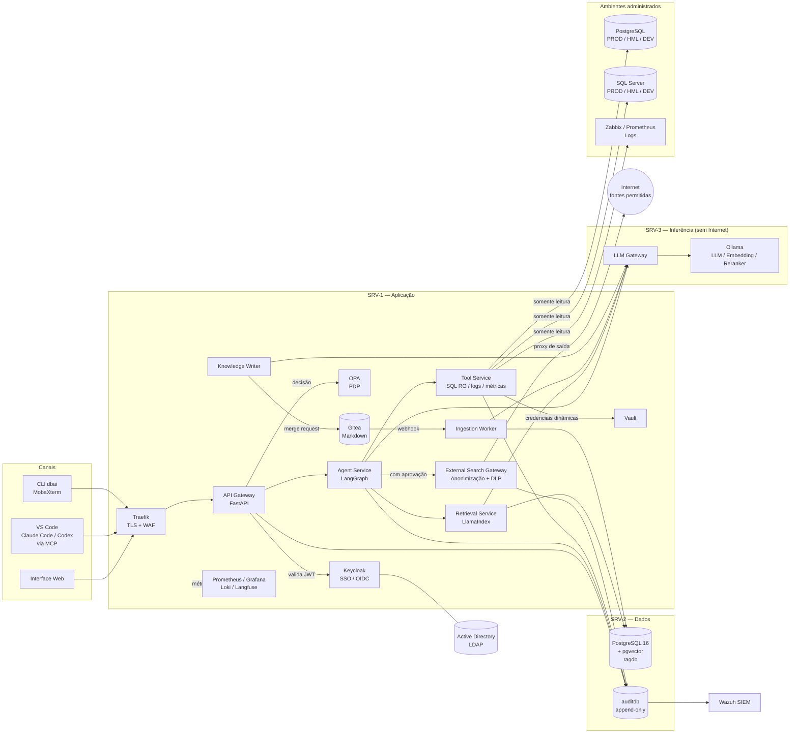
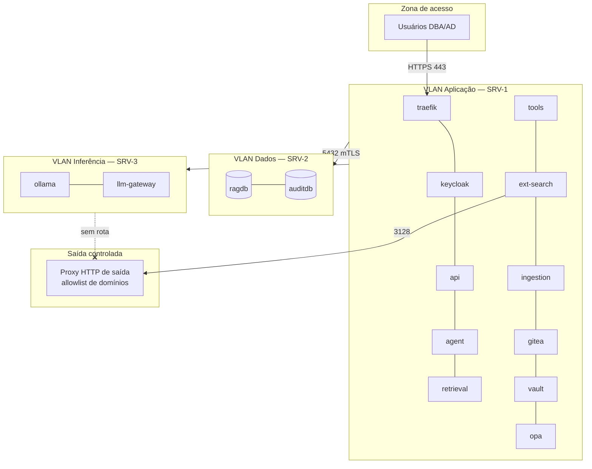
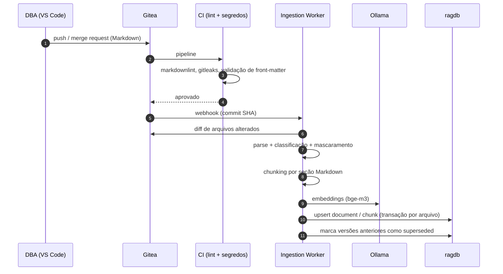

# 02 — Diagramas

Diagramas em Mermaid (renderizam no VS Code com a extensão *Markdown Preview Mermaid Support* e nativamente no GitLab/Gitea/GitHub).

## 2.1 Diagrama de componentes

## 2.2 Diagrama de implantação (protótipo)

Regras de *firewall* resumidas:

| Origem | Destino | Porta | Observação |
|--------|---------|-------|------------|
| Usuários | SRV-1 | 443 | Única porta exposta |
| SRV-1 | SRV-2 | 5432 | TLS obrigatório (`hostssl` + certificado cliente) |
| SRV-1 | SRV-3 | 11434 (via llm-gateway 8443) | mTLS |
| SRV-1 (`tool-service`) | Bancos alvo | 5432 / 1433 | Somente a partir do IP do tool-service |
| SRV-1 (`ext-search-gateway`) | Proxy de saída | 3128 | Allowlist de domínios |
| SRV-3 | Internet | — | **Bloqueado** |

## 2.3 Fluxo de dados da ingestão

