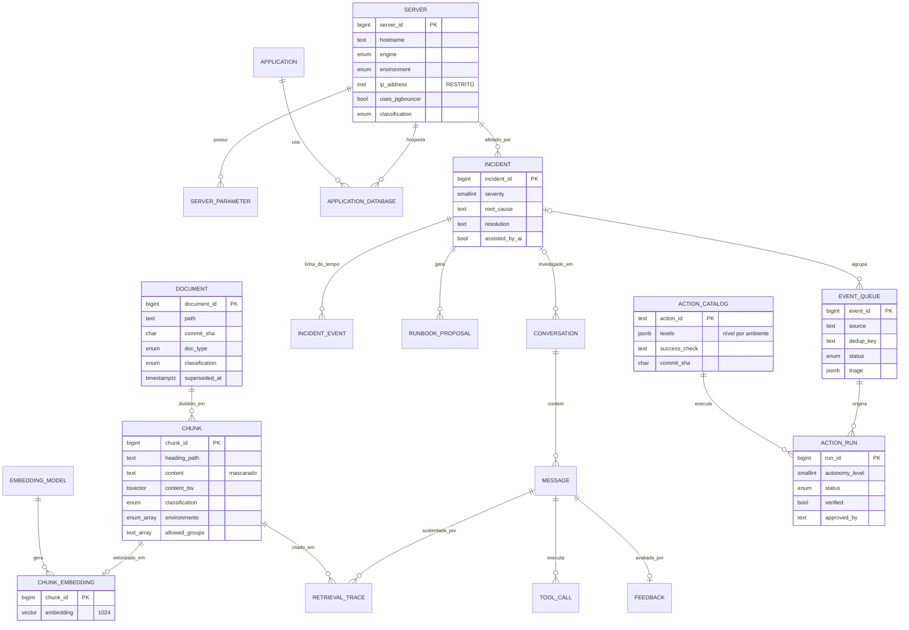

# 03 — Modelo de Dados

DDL completo e **validado em PostgreSQL 16.15 + pgvector 0.8.0** em `sql/`:

| Arquivo | Base | Conteúdo |
|---------|------|----------|
| `sql/01_schema_core.sql` | ragdb | Esquemas `catalog`, `kb`, `ops`, `conv`, `sec` |
| `sql/02_vector.sql` | ragdb | Tabela de embeddings, índice HNSW, função `kb.hybrid_search` |
| `sql/03_rls_roles.sql` | ragdb | Papéis, contexto de sessão, políticas RLS, visão mascarada |
| `sql/04_audit.sql` | auditdb | Auditoria append-only com cadeia de hash |
| `sql/05_aiops.sql` | ragdb | Fila de eventos, catálogo de ações automatizáveis e execuções (doc 13) |

## 3.1 Organização por esquemas

| Esquema | Finalidade | Quem escreve | Quem lê |
|---------|-----------|--------------|---------|
| `catalog` | Inventário: servidores, parâmetros, aplicações | ingestion-worker | agente (via visão mascarada) |
| `kb` | Documentos versionados e *chunks* | ingestion-worker | retrieval-service (sob RLS) |
| `ops` | Incidentes, linha do tempo, propostas de runbook; fila de eventos, catálogo de ações e execuções (AIOps) | agent-service, knowledge-writer, event-orchestrator, action-executor, log-processor, ingestion-worker (catálogo) | agent-service, event-orchestrator, action-executor |
| `conv` | Conversas, mensagens, rastreabilidade (chunks citados, ferramentas, feedback) | agent-service | próprio usuário (RLS) e pesquisadores (visão anonimizada) |
| `sec` | Dicionário de entidades sensíveis → pseudônimos | ingestion-worker | **somente** ext-search-gateway |
| `audit` (outra base) | Eventos de segurança imutáveis | todos os serviços (INSERT) | auditor/segurança |

Separar esquemas por responsabilidade permite conceder privilégios por papel de serviço (menor privilégio) e facilita a migração futura de um esquema para outro banco/serviço.

## 3.2 Diagrama entidade-relacionamento



## 3.3 Decisões de modelagem

1. **Versionamento por commit (`kb.document`)** — cada versão de um arquivo é uma linha; a vigente tem `superseded_at IS NULL` (índice único parcial garante uma só). Permite responder "o que a documentação dizia quando o incidente X ocorreu?" e reproduzir respostas antigas (P7).
2. **Atributos de segurança desnormalizados no chunk** — `classification`, `environments`, `allowed_groups` são copiados do documento (ou restringidos por seção). A política RLS avalia o próprio registro, sem JOIN, o que mantém a busca vetorial rápida e permite que uma seção "RESTRITO" dentro de um documento "INTERNO" seja protegida individualmente.
3. **Embedding em tabela separada** — troca de modelo sem tocar em `kb.chunk`; dois modelos podem coexistir durante a migração e nos experimentos comparativos (doc 10).
4. **`content_tsv` gerado** — busca léxica nativa (sem Elasticsearch), essencial para termos exatos: nomes de parâmetros (`shared_buffers`), códigos de erro (`40P01`, `Msg 1205`), nomes de *wait types* (`PAGEIOLATCH_SH`).
5. **Inventário estruturado (`catalog`)** — perguntas como "Quais servidores utilizam pgBouncer?" são respondidas com SQL determinístico sobre `catalog.server_v`, não por similaridade semântica (que é imprecisa para enumerações). O agente escolhe a ferramenta (doc 05).
6. **Rastreabilidade (`conv.retrieval_trace`, `conv.tool_call`)** — cada resposta registra quais *chunks* (e de qual commit) e quais ferramentas a sustentaram; base para métricas de fidelidade e para auditoria.
7. **`ops.incident.assisted_by_ai`** — variável de tratamento para o estudo de MTTR (H4).
8. **Fila de eventos em tabela (`ops.event_queue`)** — consumida com `FOR UPDATE SKIP LOCKED`; `dedup_key` + índice único parcial impedem dois eventos abertos iguais (ADR-013).
9. **Catálogo derivado do Git (`ops.action_catalog`)** — sincronizado do bloco `automacao` dos runbooks; `commit_sha` amarra cada execução à versão revisada. Nível 3 é proibido por `CHECK` (ADR-014).
10. **Execuções (`ops.action_run`)** — uma linha por decisão, inclusive as de nível 0; o papel do executor só pode atualizar campos de resultado. É a base da verificação pós-ação e da avaliação de H5 (ADR-015).

## 3.4 Fonte dos dados: front-matter dos documentos Markdown

O inventário e a classificação nascem do próprio Markdown. Modelo em `templates/servidor.md`:

```yaml
---
tipo: CONFIGURACAO_SERVIDOR
servidor: PG-PROD02
sgbd: POSTGRESQL
versao: "16.4"
ambiente: PROD
ha: primary
pgbouncer: true
classificacao: CONFIDENCIAL     # PUBLICO | INTERNO | CONFIDENCIAL | RESTRITO
grupos: [dba-pg]
responsavel: equipe-dba
tags: [sigaa, alta-criticidade]
---
```

Seções podem elevar a classificação localmente:

```markdown
## Endereçamento de rede <!-- classificacao: RESTRITO -->
```

## 3.5 Testes realizados (2026-11-10)

| Teste | Resultado |
|-------|-----------|
| Sessão sem variáveis de contexto consulta `kb.hybrid_search` | 0 linhas (fail-closed) ✔ |
| Perfil INTERNO / DEV | apenas runbook INTERNO ✔ |
| Perfil CONFIDENCIAL sem grupo `dba-senior` | não vê política restrita ao grupo nem doc RESTRITO ✔ |
| Perfil RESTRITO / PROD / `dba-senior` | vê os 3 documentos ✔ |
| Papel de recuperação lê `catalog.server` diretamente | `permission denied` (só visão mascarada) ✔ |
| `UPDATE` em `audit.event` (até como superusuário) | bloqueado por *trigger* ✔ |
| `audit.verify_chain` após 3 inserções | cadeia íntegra ✔ |
| Papel `audit_writer` tenta `SELECT` | `permission denied` ✔ |

**AIOps — `sql/05_aiops.sql` (2026-11-11, PostgreSQL 16 + pgvector)**

| Teste | Resultado |
|-------|-----------|
| Mesmo `dedup_key` publicado duas vezes | 1 evento, `repeticoes = 2` ✔ |
| Dois orquestradores chamam `ops.claim_events` ao mesmo tempo | lotes disjuntos, sem espera (`SKIP LOCKED`) ✔ |
| Catálogo com nível 3, ação irreversível em nível 1, ação habilitada sem revisor, credencial fora do padrão `<usuario>.vault` | rejeitados por `CHECK` ✔ |
| Execução de nível 2 sem aprovação; nível 3 executando; nível 0 com ação | rejeitados por `CHECK` ✔ |
| Executor tenta alterar `approved_by` | `permission denied` ✔ |
| Status `SUCESSO` sem `verified = true` | rejeitado por `CHECK` ✔ |
| Alteração de execução finalizada; `DELETE` em `ops.action_run` | bloqueados por *trigger* ✔ |
| `log-processor` insere direto na fila | `permission denied` (só via `ops.publish_event`) ✔ |
