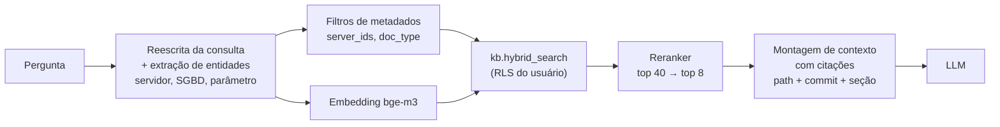

# 04 — Modelo do Banco Vetorial

## 4.1 Por que pgvector (e não um banco vetorial dedicado)?

| Critério | pgvector | Qdrant / Milvus / Weaviate |
|----------|----------|----------------------------|
| Autorização no dado | **RLS nativa**, mesma transação, mesma política para texto, vetor e metadados | Filtros de *payload* controlados pela aplicação — a aplicação vira o ponto único de falha da autorização |
| Busca híbrida | `tsvector` + vetor na mesma consulta SQL | Requer motor léxico separado ou recurso específico |
| Operação | A equipe **já administra PostgreSQL** (backup, réplica, monitoramento Zabbix) | Nova tecnologia para operar e proteger |
| Escala | Confortável até dezenas de milhões de vetores com HNSW | Superior em centenas de milhões |
| Volume previsto | Milhares de documentos → 10⁴–10⁶ *chunks* | — |

Conclusão: para o volume e, principalmente, para o requisito de **"a IA nunca poderá revelar informações além das permissões do usuário"**, pgvector + RLS é a escolha mais segura e simples (ADR-002). A interface de recuperação é abstraída pelo LlamaIndex (`PGVectorStore` ou recuperador customizado chamando `kb.hybrid_search`), permitindo migração futura.

## 4.2 Estratégia de *chunking*

Documentos de DBA têm estrutura forte (títulos, blocos de código, tabelas). Corte por número fixo de caracteres quebra scripts e procedimentos ao meio. Estratégia adotada:

1. **Divisão hierárquica por títulos Markdown** (`#`, `##`, `###`) → cada seção é candidata a *chunk*; o caminho de títulos vira `heading_path` (`PG-PROD02 > Backup > Restauração PITR`) e é **prefixado ao texto antes do embedding** (contexto).
2. **Blocos de código são atômicos** — um bloco ` ```sql ` nunca é dividido; vira `chunk_kind = 'codigo_sql'`. Se exceder o limite, é mantido inteiro e indexado com um resumo gerado pelo LLM como texto de busca.
3. **Tamanho alvo**: 300–800 *tokens*, sobreposição de ~10% apenas para texto corrido.
4. **Tabelas Markdown** mantidas inteiras, com o cabeçalho repetido se forem divididas.
5. **Front-matter** não vira *chunk*; vira metadados (`catalog`, `classification`, `server_ids`).
6. **Enriquecimento**: `metadata` recebe `doc_type`, servidor, SGBD, versão, comandos/parâmetros detectados (regex: `shared_buffers`, `ALTER SYSTEM`, `DBCC`, `sp_configure`), para filtros e *boost*.

## 4.3 Modelos de embedding e reranking (via Ollama, locais)

| Função | Modelo de referência | Justificativa | Alternativas a avaliar (doc 10) |
|--------|---------------------|---------------|-------------------------------|
| Embedding | `bge-m3` (1024 dim) | Multilíngue (PT/EN — documentação interna em português, oficial em inglês), contexto longo (8k) | `nomic-embed-text`, `mxbai-embed-large`, `snowflake-arctic-embed2`, `qwen3-embedding` |
| Reranker | `bge-reranker-v2-m3` (*cross-encoder*) | Ganho de precisão no topo (top-5) com custo baixo sobre 20–40 candidatos | LLM como reranker (mais caro) |

> Versões e disponibilidade de modelos mudam rapidamente; confirmar no momento da implantação e registrar o *digest* em `kb.embedding_model.digest`.

## 4.4 Pipeline de recuperação



- **Reescrita**: "Por que o PG-PROD02 teve CPU alta?" → entidades `{servidor: PG-PROD02, sintoma: CPU}` → filtro `server_ids` + consultas paralelas ("CPU alta PostgreSQL", "PG-PROD02 incidentes").
- **RRF (Reciprocal Rank Fusion)** combina rankings vetorial e léxico sem calibrar escalas de escore — robusto e sem parâmetros sensíveis.
- **Limiar de suficiência**: se o melhor `rerank_score` < τ (calibrado no experimento), o agente considera o conhecimento interno insuficiente (gatilho para perguntar sobre pesquisa externa — doc 07).

## 4.5 Parâmetros do índice HNSW

| Parâmetro | Valor inicial | Observação |
|-----------|---------------|-----------|
| `m` | 16 | Conexões por nó; padrão adequado até ~10⁶ vetores |
| `ef_construction` | 128 | Mais qualidade na construção; ingestão é *batch* |
| `hnsw.ef_search` | 80 (sessão) | Aumentar quando filtros RLS são muito seletivos |
| `hnsw.iterative_scan` | `relaxed_order` | pgvector ≥ 0.8: evita retorno de menos de *k* linhas quando RLS/filtros descartam muitos candidatos |
| Distância | cosseno | Embeddings normalizados |

Futuro (> 5 M vetores): `halfvec(1024)` reduz memória pela metade com perda mínima de *recall*; particionamento de `kb.chunk` por `doc_type` ou ambiente.

## 4.6 Troca de modelo de embedding (reindexação sem indisponibilidade)

1. Registrar novo modelo em `kb.embedding_model` (`active = false`).
2. Criar `kb.chunk_embedding_<modelo>` + índice HNSW.
3. Ingestion-worker preenche em segundo plano.
4. Avaliar no conjunto de teste (doc 10). Se superior, alternar `active`, apontar o retrieval-service para a nova tabela.
5. Remover a tabela antiga após período de observação.

## 4.7 Consistência Git ↔ índice

- O índice é **derivado**: `reindex --from-scratch` reconstrói tudo a partir do repositório (recuperação de desastre e prova de reprodutibilidade).
- Cada `kb.document` guarda `commit_sha` e `content_hash`; job diário compara o HEAD do Git com o índice e reporta divergências ao Prometheus (`rag_index_drift_documents`).
