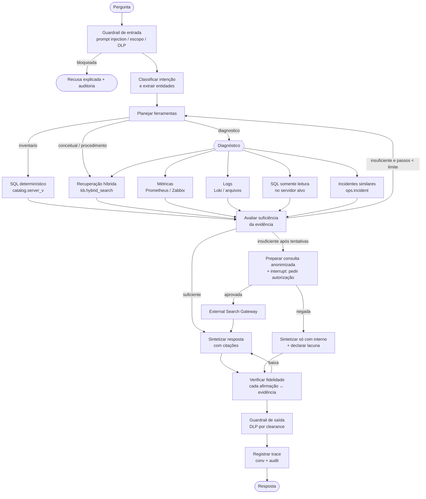

# 05 — Agente Inteligente (LangGraph)

## 5.1 Por que LangGraph

O agente precisa decidir dinamicamente entre ferramentas, **pausar para pedir autorização humana** (pesquisa externa) e retomar do ponto em que parou. LangGraph oferece:

- grafo de estados explícito (auditável, testável nó a nó — diferente de um laço ReAct opaco);
- *checkpointer* persistente em PostgreSQL (`langgraph-checkpoint-postgres`) → retomada após aprovação, mesmo horas depois;
- `interrupt()` nativo para *human-in-the-loop*;
- limites de passos (proteção contra laços).

LlamaIndex é usado **dentro** dos nós de recuperação/ingestão (ponto forte da biblioteca), e LangGraph na orquestração — cada um na sua especialidade (ADR-003).

## 5.2 Estado do agente

```python
class AgentState(TypedDict):
    trace_id: str
    user: UserContext            # sub, grupos, clearance, ambientes (do JWT + OPA)
    question: str
    intent: Literal["conceitual", "procedimento_interno", "inventario",
                    "diagnostico", "otimizacao", "incidente_novo"]
    entities: dict               # servidor, sgbd, parametro, erro
    plan: list[str]              # ferramentas planejadas
    evidence: list[Evidence]     # chunks, resultados SQL, métricas, logs (com origem)
    sufficiency: float           # 0..1 — conhecimento interno basta?
    external_request: ExternalRequest | None
    external_approved: bool | None
    draft_answer: str
    groundedness: float
    steps: int                   # limite rígido (ex.: 8)
```

## 5.3 Grafo



## 5.4 Regras de decisão (heurísticas + LLM)

| Situação | Decisão | Exemplo |
|----------|---------|---------|
| Pergunta enumerativa sobre o parque | Ferramenta `inventario` (SQL), **não** RAG | "Quais servidores utilizam pgBouncer?" |
| Pergunta sobre política/procedimento interno | RAG filtrado por `doc_type ∈ {POLITICA, PROCEDIMENTO, RUNBOOK}`; se nada for encontrado, **responder que não existe procedimento interno documentado** — nunca inventar | "Existe procedimento interno para alteração do shared_buffers?" |
| Pergunta conceitual genérica | RAG interno primeiro (a equipe pode ter padrão próprio); se insuficiente, conhecimento do modelo, **sinalizado como não-interno** | "Como criar um usuário PostgreSQL?" |
| Localizar runbook | RAG com `doc_type = RUNBOOK` + busca léxica pelo termo | "Qual runbook trata deadlocks?" |
| Diagnóstico de servidor específico | Plano multi-ferramenta: métricas do período → logs → `pg_stat_statements` / DMVs → incidentes similares → runbooks | "Por que o PG-PROD02 apresentou alto consumo de CPU?" |
| Problema inédito (nada interno, nada histórico) | Hipóteses com base no modelo + **pedido de autorização** para pesquisa externa | "erro novo após atualização de CU" |
| Pedido de ação de escrita | Recusar execução; gerar o script para o DBA revisar e executar | "Mate a sessão bloqueadora" |

**Suficiência** = combinação de: maior `rerank_score`, cobertura das entidades da pergunta pela evidência, e autoavaliação do LLM ("a evidência responde à pergunta? sim/parcial/não"). Pesos calibrados no experimento.

## 5.5 Ferramentas

| Ferramenta | Entrada | Proteções |
|-----------|---------|-----------|
| `buscar_documentacao` | consulta, filtros | RLS do usuário |
| `consultar_inventario` | filtros estruturados (não SQL livre) | Visão mascarada `catalog.server_v` |
| `sql_somente_leitura` | **consulta de um catálogo pré-aprovado** (ex.: `top_queries_cpu`, `bloqueios_atuais`, `wait_stats`), parâmetros tipados | OPA (usuário × servidor × ambiente × consulta); credencial dinâmica do Vault com papel `pg_monitor` / `VIEW SERVER STATE`; `default_transaction_read_only=on`; `statement_timeout=5s`; limite de linhas; resultado mascarado |
| `consultar_metricas` | servidor, métrica, janela | PromQL/Zabbix API gerados a partir de *templates*; somente leitura |
| `buscar_logs` | servidor, padrão, janela | Somente arquivos permitidos; mascaramento de usuários/IPs na saída |
| `incidentes_similares` | sintomas | Busca vetorial em `ops.incident` + RLS |
| `pesquisa_externa` | consulta **já anonimizada** | Só executa com `external_approved = true` (doc 07) |

**Por que catálogo de consultas e não *text-to-SQL* livre?** SQL gerado por LLM contra produção é risco de disponibilidade (consulta pesada) e de exfiltração (consultar tabelas de negócio). O catálogo cobre o diagnóstico típico de DBA e é revisado pela equipe. *Text-to-SQL* livre fica restrito, no roadmap, a DEV e ao esquema `catalog`.

Exemplos de entradas do catálogo (PostgreSQL / SQL Server):

```yaml
- id: top_queries_cpu
  sgbd: POSTGRESQL
  requer: [pg_stat_statements]
  sql: |
    SELECT queryid, calls, round(total_exec_time::numeric,0) AS total_ms,
           round(mean_exec_time::numeric,2) AS mean_ms, rows,
           left(query, 200) AS query
    FROM pg_stat_statements
    ORDER BY total_exec_time DESC
    LIMIT :limite
- id: wait_stats
  sgbd: SQLSERVER
  sql: |
    SELECT TOP (:limite) wait_type, wait_time_ms, signal_wait_time_ms, waiting_tasks_count
    FROM sys.dm_os_wait_stats
    WHERE wait_type NOT LIKE 'SLEEP%' AND wait_type NOT IN ('BROKER_TASK_STOP','XE_TIMER_EVENT')
    ORDER BY wait_time_ms DESC;
```

## 5.6 Seleção de modelos por tarefa (LLM Gateway)

| Tarefa | Requisito | Perfil de modelo (local) |
|--------|-----------|---------------------------|
| Classificação de intenção, extração de entidades | Rápido, saída JSON | Modelo pequeno (3–8B) |
| Planejamento, *tool calling*, síntese | Raciocínio, *function calling* confiável, contexto ≥ 32k | Modelo médio (20–32B, quantização Q4/Q5) |
| Verificação de fidelidade | Comparação texto↔evidência | Modelo médio ou NLI dedicado |
| Geração de runbook | Escrita estruturada | Modelo médio |

Famílias candidatas (abertas, executáveis no Ollama): Qwen, Llama, Mistral, Gemma, gpt-oss. A escolha final é **resultado experimental** (doc 10), não premissa.

## 5.7 Formato da resposta

```
**Resposta**
<texto>

**Fontes internas**
[1] runbooks/deadlock.md › Diagnóstico (commit a1b2c3d, 2026-10-02)
[2] servidores/PG-PROD02.md › Parâmetros (commit 9f8e7d6)

**Evidências coletadas**
- top_queries_cpu @ PG-PROD02 (14:32) — 3 consultas = 71% do tempo total

**Confiança**: alta | **Origem**: 100% interna
**Ações sugeridas** (execução manual pelo DBA): ...
```

Toda afirmação técnica deve apontar uma fonte; conhecimento do modelo sem fonte aparece marcado como "*conhecimento geral do modelo — validar*".
