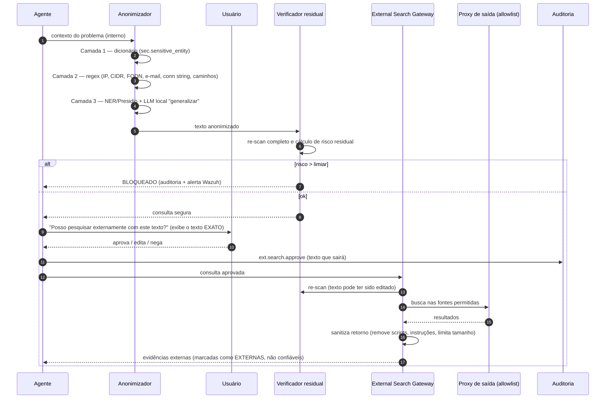

# 07 — Pesquisa Externa e Estratégia de Anonimização

## 7.1 Regra de ouro

**Nada que identifique a organização ou seus ativos sai do perímetro.** A consulta externa descreve apenas o *problema técnico genérico*: SGBD, versão, sintoma, mensagem de erro (sanitizada), parâmetros padrão.

| Pode sair | Nunca sai |
|-----------|-----------|
| "PostgreSQL 16.4, deadlock 40P01 entre UPDATE em tabela filha e DELETE na pai, FK sem índice" | `PG-PROD02`, `10.20.30.40`, `sigaa_prod`, `usr_batch_folha` |
| "SQL Server 2022 CU14, Always On, espera HADR_SYNC_COMMIT elevada após failover" | Nome do *listener*, do AG, do domínio AD |
| Valor de parâmetro genérico ("shared_buffers 25% da RAM de 64 GB") | Configuração completa do servidor, topologia |

## 7.2 Fluxo

## 7.3 Anonimização em três camadas

**Camada 1 — Dicionário determinístico (alta precisão).**
`sec.sensitive_entity` é alimentada automaticamente com tudo que a organização *sabe* que é sensível: *hostnames* e *aliases* do `catalog.server`, IPs, nomes de bancos, logins (coletados dos catálogos `pg_roles`/`sys.server_principals` pelo tool-service), nomes de aplicações, domínios, contas do AD da equipe. Substituição por pseudônimo estável (`<HOST_7>`), o que preserva a semântica ("o primário `<HOST_7>` replica para `<HOST_8>`").

**Camada 2 — Expressões regulares (cobertura de formatos).**
IPv4/IPv6/CIDR, FQDN do domínio interno, e-mail, CPF/CNPJ, *connection strings* (`host=... user=...`, `Server=...;User Id=...`), caminhos de arquivo (`/pgdata/...`, `D:\MSSQL\...`), *hashes*/tokens, números de chamado.

**Camada 3 — Generalização semântica (cobertura do desconhecido).**
- Presidio (NER) para nomes de pessoas e organizações.
- LLM **local** com instrução de reescrever o problema "como uma pergunta de fórum técnico, sem nenhum identificador", seguido de nova passagem das camadas 1 e 2 sobre a saída (o LLM pode reintroduzir termos).

**Verificação residual (independente).**
Re-scan com as três camadas + teste de *k*-anonimato simples: termos raros (frequência ~0 em um corpus técnico público de referência) e que aparecem no corpus interno são tratados como possíveis identificadores → bloqueio ou pedido de edição.

**Mensagens de erro e logs**: normalizadas antes (remover *timestamps*, PIDs, nomes de objetos de negócio → `<TABELA_A>`), preservando códigos (`SQLSTATE 40P01`, `Msg 1205`).

## 7.4 Fontes permitidas (allowlist no proxy)

| Fonte | Domínios |
|-------|----------|
| Documentação oficial PostgreSQL | `postgresql.org` |
| Microsoft Learn / SQL Server | `learn.microsoft.com` |
| CVEs | `nvd.nist.gov`, `cve.org`, `postgresql.org/support/security` , `msrc.microsoft.com` |
| GitHub Issues | `github.com` (somente leitura, via API) |
| Stack Overflow / DBA Stack Exchange | `stackoverflow.com`, `dba.stackexchange.com` |
| Blogs técnicos selecionados | lista curada pela equipe (revisada trimestralmente) |

Motor de busca: API de busca corporativa ou instância **SearXNG** própria configurada apenas com as fontes acima (evita enviar consultas a buscadores gerais e permite controlar a lista).

## 7.5 Tratamento do retorno

- Conteúdo externo é **dado não confiável**: entra no prompt delimitado e rotulado; instruções contidas nele são ignoradas (mitigação de *prompt injection* indireta).
- Respostas com fonte externa recebem selo "**Origem: externa**" e link; recomendações de alteração em produção exigem confronto com política interna.
- Se a solução externa resolver o incidente, ela entra no ciclo de aprendizado (doc 08) como runbook interno revisado.

## 7.6 Modos de autorização

| Modo | Quando |
|------|--------|
| **Aprovação por consulta** (padrão) | Usuário vê e aprova o texto exato que sairá |
| Aprovação + supervisor | Incidentes classificados RESTRITO ou perfil estagiário |
| Desabilitado | *Kill switch* via OPA (incidente de segurança, auditoria) |

Nunca existe modo "automático sem aprovação" — decisão de projeto (ADR-005).

## 7.7 Medição

Ver doc 10: taxa de vazamento (entidades sensíveis que passaram), taxa de bloqueio indevido (falsos positivos que impediram pesquisa útil) e utilidade da consulta anonimizada (o resultado externo ainda foi relevante?).
