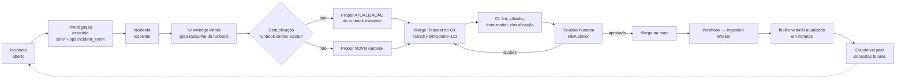

# 08 — Estratégia de Aprendizado Contínuo

## 8.1 Princípio

"Aprender" **não** significa re-treinar o modelo. Significa **ampliar e corrigir a base de conhecimento** de forma revisada e versionada. Vantagens: auditável, reversível (Git), sem custo de GPU para *fine-tuning*, sem risco de o modelo "memorizar" dados sensíveis.

O ajuste fino, quando houver (ADR-011), é separado deste ciclo: é condicional a uma lacuna medida, restrito a vocabulário, estilo e formato, feito no LMISup com dados internos (ADR-018) — nunca para ensinar fatos da infraestrutura, que ficariam nos pesos sem controle de acesso.

## 8.2 Ciclo

## 8.3 Geração do runbook

Entrada para o LLM local:
- dados do incidente (`ops.incident`: sintomas, causa raiz, resolução);
- linha do tempo (`ops.incident_event`: hipóteses descartadas, evidências, ações);
- trechos da conversa de investigação;
- runbooks semelhantes (para manter estilo e evitar duplicação);
- *template* `templates/runbook.md`.

Saída: Markdown com front-matter preenchido, seções fixas (Sintomas, Diagnóstico, Causa raiz, Resolução, Prevenção, Referências), scripts em blocos de código, `origem: incidente-<id>`, `gerado_por: ia`, `revisado_por: <pendente>`.

Regras:
- Classificação herdada do incidente (mínimo CONFIDENCIAL se citar servidor específico); o *writer* produz também uma **versão generalizada** (sem servidor) como INTERNO quando a solução for reutilizável.
- Nunca incluir senhas; credenciais referenciadas como `<usuario>.vault`.
- Comandos destrutivos marcados com aviso e passo de confirmação.
- Runbooks gerados por IA **nunca** recebem o bloco `automacao` (doc 13): a inclusão no catálogo de ações automatizáveis exige MR próprio, revisado por DBA sênior.

## 8.4 Deduplicação e consolidação

- Similaridade do rascunho com runbooks existentes (embedding + título). Acima do limiar → MR de **atualização** (seção "Ocorrências" recebe o novo incidente; diagnóstico é enriquecido).
- Job mensal identifica *clusters* de runbooks muito semelhantes e propõe consolidação.

## 8.5 Outros sinais de aprendizado

| Sinal | Ação |
|-------|------|
| Feedback 👎 "desatualizada" | Abre tarefa para o responsável do documento citado |
| Perguntas sem resposta interna recorrentes | Relatório semanal de "lacunas de conhecimento" → backlog de documentação |
| Documento nunca recuperado em 6 meses | Candidato a revisão/arquivamento |
| Divergência documentação × coleta automática (ex.: `shared_buffers` documentado ≠ real) | Alerta de *drift* de configuração + proposta de atualização do .md |
| Pesquisa externa que resolveu um caso | Vira runbook interno (fecha a lacuna) |
| Ação de nível 2 sempre aprovada sem divergência | Candidata a promoção de nível (doc 13 §13.8), por MR revisado |
| Padrão de log novo recorrente (doc 14) | Proposta de runbook e de regra determinística |

## 8.6 Governança

- Nenhum conteúdo gerado por IA entra na base sem aprovação humana (requisito de pesquisa e de segurança contra envenenamento).
- Métricas do ciclo: tempo incidente→runbook publicado, % de incidentes que geram runbook, taxa de aprovação sem edição, reuso (quantas vezes o runbook foi citado depois).
