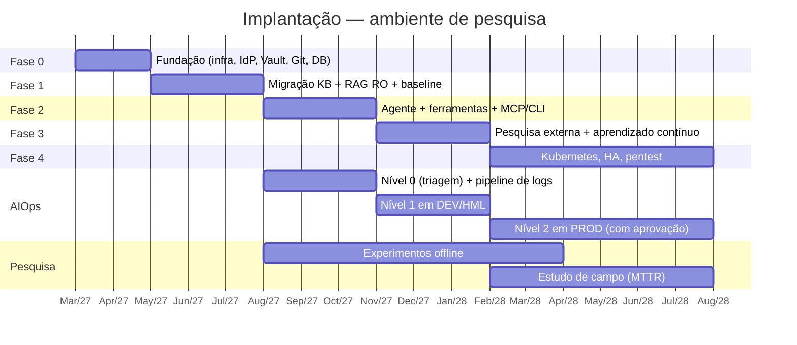

# 09 — Plano de Implantação

Abordagem incremental: cada fase entrega valor utilizável e gera dados para a pesquisa. Segurança não é fase final — cada fase tem seus controles mínimos.

## Fase 0 — Fundação (meses 1–2)

| Entrega | Detalhe |
|---------|---------|
| Infraestrutura | 3 servidores provisionados, VLANs, regras de *firewall* (doc 02), Docker |
| Identidade | Keycloak federado ao AD; grupos `GG-DBA-*` mapeados |
| Segredos | Vault inicializado; engines database, PKI, KV |
| Git | Gitea; repositório `dba/conhecimento`; pré-commit + CI com *markdownlint* e *gitleaks* |
| Banco | ragdb/auditdb com `sql/01–04` |
| Observabilidade | Prometheus, Grafana, Loki, agente Wazuh |
| Governança | RIPD (LGPD) iniciado; submissão ao CEP do protocolo de avaliação |
| LMISup | Contato com o laboratório (lmisup@unb.br): condições de acesso, modalidade (filas em lote ou serviço de inferência), política de dados, saída dos pesos derivados para a STI (ADR-010) |

## Fase 1 — Base de conhecimento e RAG somente leitura (meses 3–5)

- Migração do conteúdo do Teams para Markdown com *templates* (servidor, runbook, incidente, política). Normalização de caracteres invisíveis (ex.: espaço não separável) que hoje quebram comandos colados no MobaXterm.
- Ingestion-worker com classificação + mascaramento.
- Retrieval-service + LLM local; interface web simples.
- **Sem ferramentas** e **sem pesquisa externa**.
- *Baseline* do experimento: conjunto de perguntas (doc 10) e MTTR histórico.

**Critério de saída**: exatidão ≥ meta no conjunto de teste; zero vazamento no teste de RLS.

## Fase 2 — Agente com ferramentas (meses 6–8)

- LangGraph com classificação de intenção, inventário, catálogo de consultas RO, métricas (Zabbix/Prometheus), logs.
- OPA para ferramentas; credenciais dinâmicas por alvo — **começando por DEV/HML**, PROD após 4 semanas sem incidentes.
- Servidor MCP para VS Code (Claude Code / Codex) com teto INTERNO; CLI `dbai` para os *jump hosts*.
- **AIOps nível 0**: `event-orchestrator` com *webhook* do Zabbix e `log-processor` (doc 14) — triagem e resumo, sem ações; medir acerto da triagem.
- Primeira rodada de avaliação de modelos no LMISup.

## Fase 3 — Pesquisa externa e aprendizado contínuo (meses 9–11)

- Anonimizador em 3 camadas + verificador residual; *red team* com corpus sintético antes de liberar.
- External Search Gateway + SearXNG + proxy *allowlist*.
- Knowledge Writer + fluxo de MR.
- Estudo de campo (H4) inicia.
- **AIOps nível 1 em DEV/HML**: `action-executor` com catálogo inicial de ações reversíveis, *dry-run* nas primeiras execuções.

## Fase 4 — Endurecimento e escala (meses 12–18)

- Migração para Kubernetes (k3s/RKE2 on-premises): namespaces por fronteira, NetworkPolicies, *service mesh* mTLS.
- Alta disponibilidade: Patroni (ragdb), Keycloak em *cluster*, Vault HA.
- vLLM para *throughput*; pool de GPUs.
- *Pentest* externo e auditoria de conformidade.
- **AIOps nível 2 em PROD**, sempre com aprovação; promoções de nível conforme histórico (doc 13 §13.8).

## Riscos do plano

| Risco | Prob. | Impacto | Mitigação |
|-------|-------|---------|-----------|
| GPU insuficiente para modelo de qualidade | Média | Alto | Avaliar no LMISup modelos de vários portes e escolher o que cabe na GPU da STI; modelos menores quantizados; priorizar recuperação de qualidade e ferramentas; solicitar GPU com antecedência |
| LMISup indisponível ou com política de dados incompatível | Média | Médio | A operação não depende do laboratório (ADR-010); avaliação com dados sintéticos/anonimizados; alternativa: avaliar só modelos que cabem no SRV-3 |
| Ação automática indevida | Baixa | Muito alto | Nível 2 com aprovação em PROD, nível 3 nunca automatizado, verificação pós-ação, disjuntor, *kill switch*, implantação gradual (doc 13) |
| Volume de logs maior que o previsto | Média | Médio | Limites conservadores de log, amostragem de padrões conhecidos, só anômalos chegam ao LLM (doc 14) |
| Documentação atual desatualizada / incompleta | Alta | Alto | Fase 1 inclui saneamento; métrica de "lacunas" orienta esforço |
| Baixa adoção pela equipe | Média | Alto | Integração com ferramentas já usadas (VS Code, MobaXterm); respostas com citação geram confiança |
| Classificação incorreta → vazamento | Baixa | Muito alto | Fail-closed, só eleva, revisão humana, testes adversariais contínuos |
| Respostas erradas aplicadas em produção | Média | Alto | Agente não executa escrita; aviso explícito; runbooks revisados |
| Dependência de bibliotecas em rápida evolução (LangGraph, LlamaIndex) | Alta | Médio | Versões fixadas, interfaces próprias, testes de regressão do agente |

## Cronograma (Gantt)

> Datas ilustrativas — ajustar ao calendário do PPCA.
