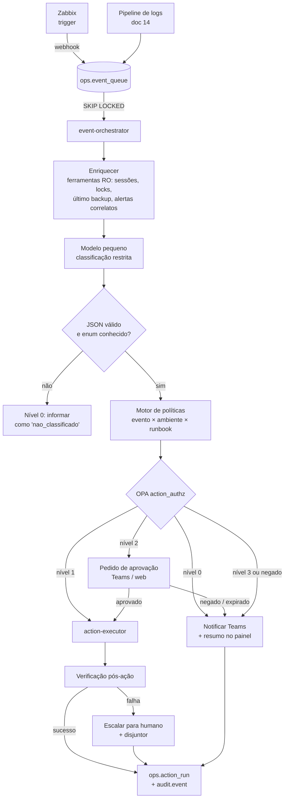

# 13 — AIOps: Operação Orientada a Eventos e Autonomia Graduada

> Decisões: ADR-013 (fila de eventos), ADR-014 (autonomia graduada e executor isolado), ADR-015 (verificação pós-ação e auditoria). Logs: doc 14.

## 13.1 Princípio

Quem **detecta**, quem **decide** e quem **executa** são componentes separados. O LLM fica no meio, com o papel mais limitado possível: transformar texto (alerta, log, contexto coletado) em **fatos estruturados** — categoria, severidade, resumo. A decisão sobre o que fazer é do motor de políticas, em código; a execução é de um processo isolado que só conhece runbooks do catálogo.

| Papel | Componente | Determinístico? |
|-------|-----------|-----------------|
| Detectar | Zabbix (triggers) e pipeline de logs (doc 14) | Sim |
| Enfileirar | `ops.event_queue` (PostgreSQL) | Sim |
| Enriquecer | `event-orchestrator` com ferramentas somente leitura (doc 05) | Sim |
| Classificar e resumir | Modelo pequeno local (ADR-011), saída JSON validada contra enum | **Não** — único passo probabilístico |
| Decidir | Motor de políticas (código versionado + OPA `action_authz`) | Sim |
| Executar | `action-executor` (credencial própria, catálogo fechado) | Sim |
| Verificar | Condição de sucesso declarada no runbook | Sim |
| Registrar | `ops.action_run` + `audit.event` (`aiops.*`) | Sim |

## 13.2 Fluxo



## 13.3 Evento e triagem

Evento normalizado (entrada da fila):

```json
{
  "source": "zabbix",
  "external_ref": "zbx-889231",
  "server": "PG-HML01",
  "environment": "HML",
  "engine": "POSTGRESQL",
  "kind": "trigger",
  "title": "Sessões idle in transaction acima de 30 min",
  "payload": { "trigger_id": 4412, "severity": "average", "value": 7 },
  "dedup_key": "PG-HML01:idle_in_tx"
}
```

Saída exigida do modelo (validada por JSON Schema; qualquer valor fora do enum → `nao_classificado`, nível 0):

```json
{
  "categoria": "sessao_idle_in_transaction",
  "severidade": "media",
  "resumo": "7 sessões da aplicação X ociosas em transação há mais de 30 min, segurando locks em 2 tabelas.",
  "confianca": 0.82
}
```

- `categoria` ∈ enum mantido junto ao catálogo (ex.: `lock_bloqueante`, `sessao_idle_in_transaction`, `espaco_disco`, `replicacao_atrasada`, `backup_falhou`, `agente_monitoramento_inativo`, `job_falhou`, `nao_classificado`).
- `confianca` é **registrada, não usada para decidir**: modelos pequenos dão palpites errados com confiança alta. A calibração é medida na avaliação (doc 10).
- O contexto enviado ao modelo é tratado como **dado não confiável** (logs, texto de consultas e mensagens de erro podem conter instruções plantadas). Mesmo manipulado, o modelo só consegue escolher uma categoria do enum, e a política decide o resto.

## 13.4 Níveis de autonomia

| Nível | O que acontece | Exemplos | Quem decide |
|-------|----------------|----------|-------------|
| **0 — Informar** | Resumo, correlação de alertas, sugestão de runbook | Qualquer evento; tudo que não estiver mapeado | Automático |
| **1 — Ação reversível** | Executa sozinho, com limites | Coletar diagnóstico (snapshot de `pg_stat_activity`/DMVs); reiniciar o Zabbix Agent 2; encerrar sessão *idle in transaction* em DEV/HML | Automático, sob OPA e limites |
| **2 — Ação com impacto** | Executa só após aprovação humana | Encerrar sessão bloqueadora em PROD; `VACUUM` emergencial; liberar espaço de arquivos temporários | Humano aprova (Teams/web) |
| **3 — Nunca automatizado** | Só informa; humano executa por fora | DDL, *failover*, alteração de permissões, troca de senhas, `DROP`, alteração de parâmetros | Somente humano |

Regras fixas:
- O **nível é do par runbook × ambiente**, não do evento: a mesma ação pode ser nível 1 em DEV e nível 2 em PROD.
- Nenhum runbook de nível 3 entra no catálogo do executor.
- Na dúvida (categoria desconhecida, evento duplicado, disjuntor aberto, *kill switch* ligado) → nível 0.

## 13.5 Catálogo de runbooks automatizáveis

Os runbooks automatizáveis são os mesmos Markdown do Git (doc 08), com um bloco `automacao` no front-matter (ver `templates/runbook.md`). O `ingestion-worker` sincroniza esse bloco para `ops.action_catalog`; o executor só aceita ações presentes ali, na versão (commit) registrada.

```yaml
automacao:
  acao_id: encerrar_idle_in_transaction
  categorias: [sessao_idle_in_transaction]
  sgbd: POSTGRESQL
  niveis: { DEV: 1, HML: 1, PROD: 2 }
  reversivel: true
  idempotente: true
  script: scripts/pg/encerrar_idle_in_tx.sh
  parametros:                    # validados por JSON Schema antes da execução
    minutos_ociosos: { tipo: inteiro, min: 15, max: 240 }
    aplicacao:       { tipo: texto, padrao: "^[a-z0-9_-]{1,40}$" }
  timeout_s: 30
  max_por_hora: 3
  credencial: aiops_executor.vault
  condicao_sucesso: >
    SELECT count(*) = 0 FROM pg_stat_activity
    WHERE state = 'idle in transaction'
      AND application_name = :aplicacao
      AND now() - state_change > make_interval(mins => :minutos_ociosos)
```

## 13.6 Executor isolado

| Controle | Implementação |
|----------|---------------|
| Credencial própria | `aiops_executor.vault` (credencial dinâmica do Vault, TTL curto), distinta do `tool-service` e sem acesso ao `ragdb` além de `ops.action_run` |
| Catálogo fechado | Só `acao_id` presentes em `ops.action_catalog` com `enabled = true` e commit conferido |
| Parâmetros | Validados por JSON Schema; nenhum texto vindo do LLM vira comando |
| *Dry-run* | Toda ação suporta simulação; obrigatório na primeira execução de uma nova versão |
| Limites | `timeout_s`, `max_por_hora` por ação × servidor, teto global por hora |
| Disjuntor | Mesma ação no mesmo servidor 3× em 1 h, ou verificação falhou → ação suspensa para aquele servidor e escalada para humano |
| *Kill switch* | Flag `data.flags.actions_disabled` no OPA desliga todas as execuções (níveis 1 e 2) imediatamente |
| Separação de rede | Executor alcança os alvos somente nas portas dos SGBDs e do agente de monitoramento; sem saída para a Internet; host do LLM sem credencial de banco |

| Componente | Credencial |
|-----------|------------|
| Assistente (chat) | Somente leitura (`tool-service`) |
| `event-orchestrator` | Somente leitura nos alvos + escrita em `ops.event_queue` e `ops.action_run` |
| `action-executor` | `aiops_executor.vault`, restrito aos scripts do catálogo |
| Host do LLM (SRV-3) | Nenhuma |

## 13.7 Verificação pós-ação e auditoria

- Cada ação declara `condicao_sucesso`; o executor a avalia depois de agir (com espera curta e nova tentativa de leitura). **Código de retorno zero não basta.**
- `ops.action_run` guarda: evento, contexto enviado ao modelo (*hash* + referência), resposta do modelo, decisão da política e versão da política, aprovador, parâmetros, resultado, verificação, duração.
- Eventos de auditoria: `aiops.event.received`, `aiops.triage`, `aiops.policy.decision`, `aiops.approval.request/grant/deny/expire`, `aiops.action.execute`, `aiops.action.verify`, `aiops.breaker.open`.
- A auditoria é também o **conjunto de dados da avaliação** (H5, doc 10).

## 13.8 Implantação gradual e promoção de nível

1. **Nível 0 apenas** — triagem e resumo; medir acerto das categorias contra a classificação dos analistas.
2. **Nível 1 em DEV e HML** — ações reversíveis com *dry-run* nas primeiras execuções.
3. **Nível 2 em PROD** — sempre com aprovação.
4. **Promoção** de uma ação (ex.: nível 2 → 1 em HML) só quando o histórico em `ops.action_run` mostrar aprovações sem divergência num número mínimo de casos e nenhuma verificação falha no período. O critério numérico é parte do protocolo definido na qualificação.

## 13.9 Relação com o assistente (doc 05)

O assistente de chat continua sem executar escrita. Quando o analista pede uma ação que existe no catálogo, o assistente cria uma **solicitação de nível 2** (aprovação) no mesmo fluxo; se a ação não existe no catálogo, gera o script para o DBA revisar e executar. Assistente e orquestrador compartilham ferramentas, modelos e auditoria.
