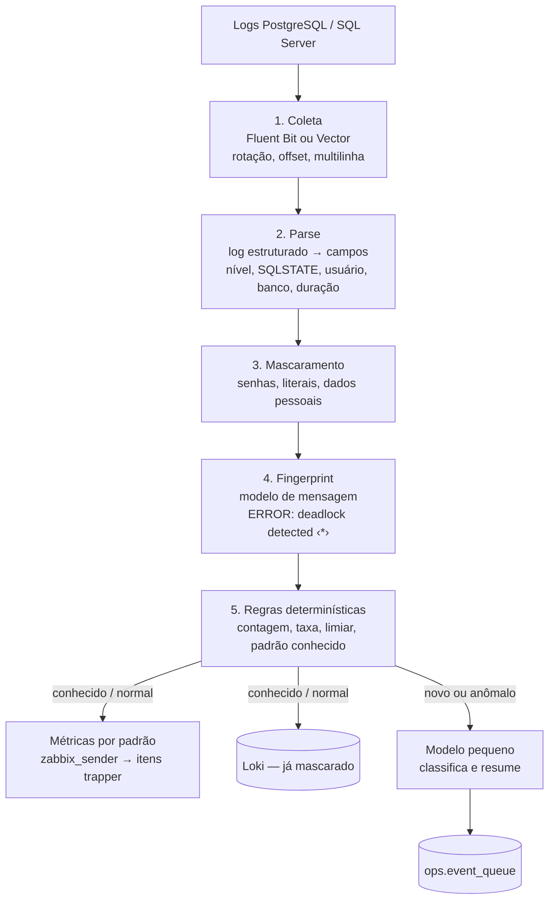

# 14 — Pipeline de Logs dos SGBDs

> Decisão: ADR-016. Os eventos produzidos aqui entram na fila do doc 13.

## 14.1 Por que um pipeline próprio

O Zabbix Agent lê arquivos de log (`log[]`, `logrt[]`, com filtro por regex e suporte a codificação — útil para o ERRORLOG em UTF-16 do SQL Server — e `eventlog[]` no Windows). Isso basta para alertar sobre padrões conhecidos (`FATAL`, `deadlock`). Não basta para entender o que está acontecendo: o Zabbix trabalha linha a linha, não trata mensagens de várias linhas, não agrupa mensagens parecidas e não correlaciona eventos.

Princípio: **o LLM não lê cada linha.** O pipeline é um funil; só o que é novo ou fora do padrão chega ao modelo, já agrupado e mascarado.

## 14.2 Funil

## 14.3 Fontes: estruturado antes de texto livre

**PostgreSQL**

| Versão | Configuração |
|--------|--------------|
| 16 | `log_destination = 'jsonlog'` (disponível a partir do 15): uma linha JSON por mensagem, *parse* trivial |
| 14 | `log_destination = 'csvlog'` |

Parâmetros que geram sinal útil: `log_lock_waits = on`, `log_autovacuum_min_duration`, `log_checkpoints = on`, `log_min_duration_statement` (com limite conservador para não inundar o pipeline) e `log_connections`/`log_disconnections` quando a auditoria exigir.

**SQL Server** — consultar a fonte em vez de seguir o arquivo:
- **Extended Events**: sessões `system_health` (deadlocks, erros graves), `AlwaysOn_health` e uma sessão própria para erros de severidade ≥ 17;
- **`sys.xp_readerrorlog`**: leitura periódica do ERRORLOG via T-SQL pelo `log-processor`, com credencial somente leitura (`aiops_logreader.vault`).

## 14.4 Componentes

| Componente | Onde roda | Responsabilidade |
|-----------|-----------|------------------|
| Fluent Bit (ou Vector) | Servidores PostgreSQL | Seguir `jsonlog`/`csvlog` com controle de *offset* e rotação; enviar ao `log-processor` por TLS |
| Coletor XE / ERRORLOG | `log-processor` (SRV-1) | Ler Extended Events e `xp_readerrorlog` dos servidores SQL Server |
| `log-processor` | SRV-1 | Mascarar, agrupar em padrões, aplicar regras, publicar métricas no Zabbix e eventos na fila |

Não se escreve o *tail* do zero: rotação, controle de *offset*, reinício sem perda e mensagens de várias linhas já estão resolvidos no Fluent Bit/Vector. O código próprio se concentra em mascaramento, agrupamento, regras e classificação.

## 14.5 Agrupamento em padrões (*fingerprint*)

- Normalização: literais numéricos e de texto, identificadores de processo, horários e nomes de objetos variáveis viram marcadores (`<*>`, `<num>`, `<str>`).
- Cada modelo de mensagem recebe um identificador estável; o `log-processor` mantém contagem por padrão × servidor × janela.
- **Padrão novo** (nunca visto naquele servidor) ou **taxa anômala** (acima da linha de base da janela) → evento para a fila.
- A técnica de referência é o agrupamento por árvore de prefixos (família Drain); a escolha final é parte da avaliação.

## 14.6 Riscos específicos de logs

| Risco | Controle |
|-------|----------|
| **Senhas em claro** — com `log_statement = 'ddl'` ou `'all'`, um `ALTER ROLE ... PASSWORD '...'` vai para o log | Mascaramento antes de qualquer armazenamento ou envio ao LLM; revisar `log_statement` nos servidores; regra de bloqueio para padrões de senha |
| **LGPD** — texto das consultas traz valores literais (CPF, nomes, matrículas) | Normalização das consultas (literais → `?`) já na coleta; dicionário `sec.sensitive_entity` aplicado ao restante |
| ***Prompt injection*** — mensagens de erro e texto de consultas são escritos por terceiros | Saída do LLM restrita a enum e validada pelo código (doc 13); conteúdo de log marcado como dado não confiável |
| **Volume** | Limites conservadores em `log_min_duration_statement`; amostragem de padrões conhecidos; só o anômalo chega ao modelo |
| **Perda de linhas** | *Offset* persistente no coletor; métrica de atraso do pipeline no Prometheus |

## 14.7 Integração

- **Zabbix**: métricas por padrão (contagem de deadlocks por hora, erros novos por servidor) via `zabbix_sender` em itens *trapper* — os alertas continuam centralizados.
- **Fila de eventos** (doc 13): padrões novos ou anômalos, com os mesmos níveis de autonomia.
- **Base de conhecimento**: padrões e resumos ficam consultáveis pelo assistente ("esse erro já apareceu antes? o que foi feito?"), ligados a `ops.incident` quando houver.
