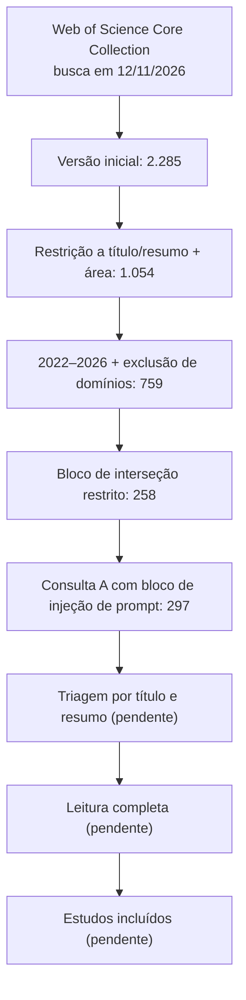
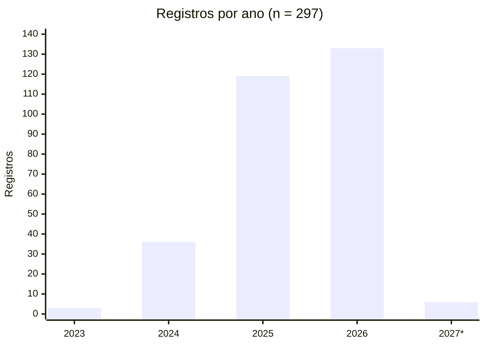

# Revisão da literatura — busca de referências

> Registro do protocolo de busca e dos achados iniciais da revisão sistemática do pré-projeto.
> Base: **Web of Science Core Collection** · Data da busca: **12/11/2026** · Resultado: **297 registros**
> Diretrizes: Kitchenham e Charters (2007), *Guidelines for Performing Systematic Literature Reviews in Software Engineering*, EBSE-2007-01.

## Conteúdo da pasta

| Arquivo | Conteúdo |
|---|---|
| `README.md` | Protocolo, histórico de refinamento, validação e achados |
| `consulta-wos.txt` | String de busca final (consulta A), pronta para colar na Pesquisa Avançada |
| `dados/wos-2026-11-12-savedrecs.bib` | Exportação bruta dos 297 registros (BibTeX, registro completo) |
| `dados/wos-2026-11-12-triagem.csv` | Planilha de triagem (separador `;`, UTF-8) com a classificação automática e colunas vazias para a decisão |
| `scripts/parse_wos_bib.py` | Leitor do BibTeX do Web of Science (sem dependências) |
| `scripts/classificar_wos.py` | Classificação heurística por eixo e subtema; gera o CSV de triagem |

Reproduzir a planilha: `cd revisao-literatura/scripts && python classificar_wos.py ../dados/wos-2026-11-12-savedrecs.bib ../dados/wos-2026-11-12-triagem.csv`

## 1. Eixos da revisão

1. **LLM aplicados à administração e operação de bancos de dados** — diagnóstico, tuning, catálogo/metadados, interfaces em linguagem natural.
2. **Segurança e privacidade em RAG** — vazamento, envenenamento da base, controle de acesso, defesas.
3. **Injeção de prompt em aplicações integradas a LLM** — incluído após a validação (ver seção 3), porque ataques de injeção indireta nem sempre são descritos como "RAG".

## 2. String de busca adotada (consulta A)

Ver `consulta-wos.txt`. Estrutura: quatro blocos unidos por `OR` (BD; RAG seguro; interseção BD + segurança/auto-hospedagem; injeção de prompt), seguidos dos filtros:

- `PY=(2022-2026)` — antes do ChatGPT (nov./2022) praticamente não há trabalhos de RAG com LLM;
- `WC=("Computer Science*")`;
- `DT=(Article OR Proceedings Paper OR Review)`;
- `LA=(English OR Portuguese)`;
- `NOT TS=(clinical OR medical OR patient* OR healthcare OR legal OR "question answering benchmark")` — exclui RAG aplicado a domínios não operacionais.

Link da consulta no Web of Science (exige acesso institucional): <https://www.webofscience.com/wos/woscc/summary/7b25d512-fb49-41e8-b0e1-c7af2d89bfe8-01d40e3411/relevance/1>

## 3. Histórico de refinamento

| Etapa | Alteração | Registros |
|---|---|---|
| 1 | Versão inicial: três blocos em `TS=` (título, resumo, palavras-chave), 2020–2026 | 2.285 |
| 2 | Blocos 1 e 2 restritos a título/resumo (`TI=`/`AB=`), filtro `WC`, sem text-to-SQL/AIOps genéricos | 1.054 |
| 3 | Período 2022–2026 e exclusão de domínios (saúde, jurídico) | 759 |
| 4 | Bloco 3 (interseção) restrito: BD e segurança exigidos no título ou resumo | 258 |
| 5 | **Consulta A consolidada**, com o bloco 4 (injeção de prompt) | **297** |

### Validação com artigos de controle

| Artigo de controle | Recuperado |
|---|---|
| Zhou et al. — *D-Bot: Database Diagnosis System using LLMs* (PVLDB 17(10), 2024) | ✅ |
| Lao et al. — *GPTuner: A Manual-Reading Database Tuning System…* (PVLDB 17(8), 2024) | ✅ |
| Zeng et al. — *The Good and The Bad: Exploring Privacy Issues in RAG* (Findings ACL 2024) | ✅ |
| Greshake et al. — *Not What You've Signed Up For…* (AISec 2023) | ✅ (só após o bloco 4; no WoS consta com Abdelnabi como primeiro autor) |

Resultado: **4 de 4**. *LLM As DBA* (Zhou, Li e Liu, arXiv:2308.05481) e *DB-GPT* não são indexados no Web of Science — cobrir por busca complementar (arXiv, ACM DL, DBLP).

### Fluxo (pré-PRISMA)

## 4. Achados iniciais (classificação automática)

> A classificação abaixo foi feita por expressões regulares sobre título e resumo (`scripts/classificar_wos.py`). Serve para planejar a triagem; **não substitui a leitura**. Os números são aproximados.

### Distribuição por ano

| 2023 | 2024 | 2025 | 2026 | 2027* |
|---|---|---|---|---|
| 3 | 36 | 119 | 133 | 6 |

\* publicações antecipadas com volume datado de 2027.

**85% dos registros (252) são de 2025–2026**: tema muito recente; a busca deve ser reexecutada (alerta no WoS) ao longo do doutorado.

### Distribuição por eixo principal

| Eixo | Registros |
|---|---|
| RAG seguro | 193 |
| LLM em bancos de dados | 65 |
| Injeção de prompt | 38 |
| Fora dos três eixos | 1 |

Tipos: 178 trabalhos em conferência e 119 em periódicos.

### Subtemas (um registro pode ter mais de um)

| Subtema | Registros |
|---|---|
| Defesas/robustez | 175 |
| Vazamento/privacidade | 80 |
| Injeção de prompt | 65 |
| Envenenamento da base | 56 |
| **Controle de acesso** | **31** |
| Tuning/configuração | 26 |
| Catálogo/metadados | 23 |
| Diagnóstico/operação | 19 |
| Otimização de consultas | 7 |
| Text-to-SQL/consulta | 6 |

Controle de acesso é o subtema de segurança menos explorado — reforça a contribuição da autorização no nível do *chunk* (H2 do README principal).

### Principais veículos

| Veículo | Registros |
|---|---|
| IEEE Access | 17 |
| Proceedings of the VLDB Endowment | 9 |
| Findings of ACL: EMNLP 2025 | 7 |
| Proceedings of the ACM on Management of Data (SIGMOD) | 6 |
| ACL 2025 (63rd Annual Meeting) | 5 |
| Expert Systems with Applications | 5 |
| Information (MDPI) | 5 |
| SIGMOD Companion 2025 | 4 |
| IEEE Transactions on Dependable and Secure Computing | 4 |
| ACM CCS 2025 | 4 |
| IEEE BigData 2025 | 4 |

Priorizar na leitura: PVLDB, SIGMOD/PACMMOD, ACM CCS, IEEE TDSC e IEEE TIFS.

### Interseção BD × segurança — a lacuna

Apenas **9 registros** combinam termos específicos de bancos de dados com termos de segurança/auto-hospedagem (coluna `intersecao_bd_seguranca` do CSV). Avaliação preliminar pelo título:

| Ano | Primeiro autor | Título | Proximidade |
|---|---|---|---|
| 2025 | Zheng et al. | *Research on Automatic Government Data Cataloging System Based on Data Architecture and Local Large Language Model: A Case Study of Suining City* | **Alta** — governo, catálogo, LLM local |
| 2026 | Liu et al. | *SafeNLIDB: A Privacy-Preserving Safety Alignment Framework for LLM-based Natural Language Database Interfaces* (AAAI-26) | **Alta** |
| 2024 | Xie et al. | *Data Security Protection and Analysis of ERP System Based on NL2SQL with LLM and Encrypted Database* | **Alta** |
| 2024 | Zhong et al. | *DBPrompt: A Database Anomaly Operation Detection and Analysis via Prompt Learning* | Média |
| 2025 | Liyanage et al. | *SqPal — text to SQL GenAI tool for PayPal* | Média |
| 2025 | Fathollahzadeh et al. | *CatDB: Data-catalog-guided, LLM-based Generation of Data-centric ML Pipelines* (PVLDB) | Média |
| 2025 | Shahab et al. | *Resilient LLM-DBMS Pipelines via Event-Driven Fallback Orchestration* | Média |
| 2024 | Pan et al. | *Survey of vector database management systems* (VLDB Journal) | Baixa (provável falso positivo) |
| 2026 | Chen et al. | *LLM-Based Test Case Generation in DBMS through Monte Carlo Tree Search* | Baixa (provável falso positivo) |

**Conclusão preliminar**: as literaturas de IA para bancos de dados e de segurança em RAG quase não se cruzam no WoS. Isso sustenta, com dados, a lacuna declarada no pré-projeto. Antes de citar qualquer um desses trabalhos, verificar a fonte (regra de `DEFINICOES.md`).

## 5. Critérios de triagem sugeridos

Ruídos observados na classificação, a tratar como critérios de exclusão em vez de alterar a string:

- **EX1** — RAG em que "database" significa apenas base de conhecimento genérica, sem relação com SGBD ou infraestrutura;
- **EX2** — ataques ou defesas de LLM em aplicações sem recuperação de conteúdo externo e fora do contexto de dados/infraestrutura (ex.: sistemas de recomendação);
- **EX3** — trabalho sem avaliação ou sem descrição técnica suficiente (resumo estendido, pôster);
- **EX4** — duplicata ou versão anterior de trabalho já incluído (ex.: demonstração do GPTuner no SIGMOD 2024 × artigo no PVLDB).

Na planilha, preencher `decisao_triagem` (Incluir / Excluir / Dúvida), `criterio` (EX1–EX4 ou motivo) e `observacao`.

## 6. Próximos passos

- [ ] Triagem por título e resumo dos 297 registros (dois revisores, se possível; Rayyan ou ASReview aceitam o `.bib`).
- [ ] Busca complementar com string equivalente em Scopus, ACM DL, IEEE Xplore e arXiv.
- [ ] Leitura completa dos incluídos e extração de dados.
- [ ] Criar alerta no WoS para a consulta A e reexecutar antes da qualificação.
- [ ] Levar os números da seção 4 para a Revisão da Literatura do pré-projeto (critério "Atualidade e relevância da revisão da literatura", Anexo IV).
